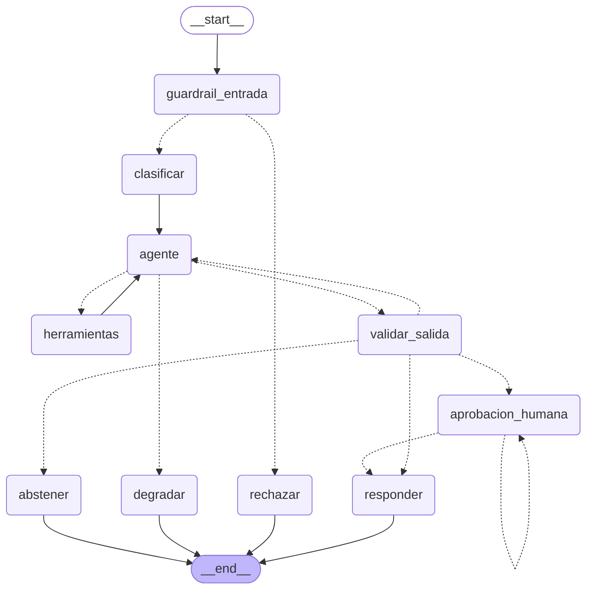

# Asistente NLP/RAG agéntico para tickets de soporte de TI

Proyecto final de CC3103 - Procesamiento de Lenguaje Natural, Universidad del Valle de Guatemala.

Asistente que ayuda al agente de soporte de nivel 1 a clasificar tickets de TI y resolverlos con
procedimientos vigentes y citas verificables. Se abstiene cuando no hay evidencia y no ejecuta
acciones críticas sin aprobación humana. Todos los datos son ficticios o públicos.

**Equipo:** Diego Linares, Christian Echeverría, Andy Fuentes y Diederich Solis.

**Plan de cierre por fases:** [docs/PLAN_CIERRE.md](docs/PLAN_CIERRE.md). La conexión local con
la suscripción de ChatGPT/Codex ya pasó una prueba real sin API key. La **fase 2 está completada**:
agente, clasificador, generador y evaluadores usan el adaptador local. La validación y sus límites
están en [el reporte de migración](resultados/conexion_suscripcion/reporte_fase_2.md).
La **fase 3 también está completada**: entrada estricta, PDF por rol, recuperación de hilos y
simulaciones aisladas. Ver [correcciones y pruebas](resultados/correcciones_fase3/reporte.md).
Los resultados guardados de Claude/Anthropic conservan su proveedor, fecha y costos históricos.

La **fase 4 de seguridad está completada**: Presidio local, recall PII de 55/56 (98.21 %) y
matriz de 12 ataques con evidencia. Ver [resultados y límites](resultados/seguridad/reporte_fase_4.md).

**Estado.** Completamos la comparación del banco oficial con 88 ejecuciones: 42 del agente,
23 de RAG y 23 de BM25. Se evaluaron también los 20 tickets de autoría humana declarada.
El informe técnico está disponible en [PDF](docs/Informe_Tecnico_CC3103.pdf) y [Word](docs/Informe_Tecnico_CC3103.docx).
La confirmación posterior aprobó los cuatro casos de regresión. La revisión humana de los 42
oráculos y nueve respuestas quedó registrada. Falta el ensayo de la defensa. Las métricas del informe siguen
correspondiendo a la evaluación completa original.
[Evaluación final](resultados/codex_suscripcion/evaluacion/banco/reporte.md) ·
[Clasificación de los 20 tickets](resultados/cierre_tecnico/clasificador_20_manuales.json).

Se conservan los reportes históricos del borrador:
[línea base](resultados/linea_base/reporte_linea_base.md), [RAG](resultados/rag/reporte_rag.md),
[herramientas](resultados/herramientas/reporte_herramientas.md) y
[evaluación con el banco borrador](resultados/evaluacion/banco_borrador/reporte.md).

## Para el equipo

- **Anteproyecto:** [docs/Anteproyecto_Proyecto_Final_CC3103.docx](docs/Anteproyecto_Proyecto_Final_CC3103.docx), la
  propuesta original. El informe técnico documenta tres decisiones que cambiaron durante la implementación:
  - La revisión humana del clasificador se activa si algún voto discrepa, no con 0.6.
  - τ vale 0.0045, no 0.30.
  - Los tickets resueltos se buscan en un canal aparte, no mezclados con los procedimientos.
- **Cómo funciona por dentro:** el diagrama de abajo y los tres reportes por fase. Cada decisión está
  justificada con números.
- **Qué sigue.** Revisar el banco y las respuestas, verificar las correcciones y ensayar la presentación.
  La [matriz de entrega](docs/ENTREGA.md) vincula cada requisito con su evidencia.
- **Proveedor.** El sistema usa la sesión local de ChatGPT/Codex con la cuota de la suscripción.
  [Guía de ejecución](docs/EJECUCION_LOCAL.md).

## La demo

[](https://youtu.be/VvRzEsFNDDE)

[Ver el video de la demostración en YouTube](https://youtu.be/VvRzEsFNDDE).

La interfaz usa la identidad **¡PILAS!**: azul, fondo marfil, acentos lima, Open Sans y el logo
extraído de la guía de marca. La distribución bento reúne los ejemplos en seis categorías y
mantiene juntos el ticket, la respuesta y sus fuentes. El [reporte de PILAS](resultados/branding_pilas/reporte.md)
registra la verificación visual y la preservación de lógica, permisos y datos.
La [primera revisión visual](resultados/rediseno_ui/reporte.md) queda como antecedente.

Una página para ver el sistema funcionando: el grafo se ilumina paso a paso mientras corre, la respuesta
trae sus citas. Cada una abre el fragmento y, cuando el rol permite el documento completo, el PDF en
la página exacta. Cuando hay una acción sensible, aparece la ventana de aprobación de N2.
Trae ejemplos para los seis puntos que pide el enunciado: consulta
nominal, trazabilidad de citas, abstención, herramientas, seguridad y fallas. La pestaña Evaluación muestra
las métricas del banco y el diagnóstico de una falla real.

La pestaña **Tickets de evaluación** permite capturar y etiquetar los veinte tickets humanos,
guardar borradores, validar y congelar el conjunto desde la aplicación. No requiere Excel ni
PostgreSQL para capturar, y esas operaciones no consumen cuota. Una vez congelado puede iniciarse
su evaluación explícitamente desde la misma pantalla; ese botón sí consume cuota incluida.
Ver [guía de captura](docs/CAPTURA_TICKETS.md).

La sección **Casos sintéticos** permite consultar veinte casos adicionales redactados por IA,
sus etiquetas justificadas y la comparación guardada de TF-IDF y el clasificador LLM. Es una
vista de solo lectura: actualizarla no inicia inferencias. Los casos sintéticos no se incorporan
al entrenamiento ni se presentan como los veinte tickets humanos. Ver
[ejecución local y evaluaciones reanudables](docs/EJECUCION_LOCAL.md) y
[análisis del conjunto sintético](resultados/cierre_tecnico/analisis_sinteticos.md).

Los PDF completos de los dos manuales están reservados a N2 porque contienen procedimientos de ambos
niveles. N1 puede leer sus fragmentos permitidos y el PDF público de Microsoft. El rol se selecciona
en esta demo local; todavía no representa autenticación de producción. Si una decisión de aprobación
es inválida, la acción sigue en pausa, se muestra el motivo y N2 puede corregirla en el mismo hilo.

```bash
uv sync --locked
cd demo && npm ci && npm run build && cd ..        # una vez, o cuando cambie la página; validado con Node 24
uv run uvicorn tickets_rag.api:app --host 127.0.0.1 --port 8000
```

Después abran `http://127.0.0.1:8000`. El backend es FastAPI (`src/tickets_rag/api.py`) y manda cada paso
del grafo con Server-Sent Events. La página es React con Vite y Tailwind (`demo/`). Para cambiar la página
con recarga en vivo: dejen corriendo uvicorn, corran `npm run dev` en `demo/` y abran `http://127.0.0.1:5173`.
La captura funciona sin base de datos. Para **Atender un ticket**, completar antes la preparación de
PostgreSQL, historial y vectores descrita abajo; el motor se inicializa al atender el primer caso.

Con el proveedor por suscripción, cada ticket consume tokens y cuota incluida de ChatGPT/Codex.
El cargo incremental de API de esta ruta es US$0; eso no significa uso ilimitado ni incluye el precio
de la suscripción. El cliente rechaza iniciar una llamada si no puede verificar la cuota, si alguna
ventana aplicable ya registra un uso de 80 % o más o si se agotó el uso incluido. Por defecto también
rechaza cuentas con saldo de créditos. `CODEX_PERMITIR_CREDITOS=1` permite iniciar con ese saldo
presente y conserva el freno del 80 %. El umbral no predice lo que gastará la llamada.
La aplicación no compra créditos ni cambia a una API key. Las fallas simuladas y los
tickets bloqueados pueden consumir menos; el clasificador también cuenta contra la cuota.

Las evaluaciones nuevas de generación y del clasificador LLM, la demo y el banco se guardan bajo
`resultados/codex_suscripcion/`. Las carpetas históricas conservan los datos de Claude sin sobrescribirlos.
La pestaña Evaluación prefiere el resumen nuevo del banco seleccionado; si todavía no existe, muestra
el resumen anterior con `historico=true` y el proveedor `anthropic_historico`, en lugar de presentarlo
como una medición de Codex.

## El grafo

Generado desde el código con `scripts/dibujar_grafo.py`. Las flechas punteadas son decisiones del grafo.

<!-- grafo:inicio -->

<!-- grafo:fin -->

Para verlo correr paso a paso en LangGraph Studio:

```bash
uv run langgraph dev --no-reload --allow-blocking
```

`--allow-blocking` hace falta porque el grafo usa llamadas síncronas (base de datos, API y modelos locales)
y el servidor de desarrollo, que es asíncrono, las rechaza por defecto.

Después abre en Chrome `https://smith.langchain.com/studio/?baseUrl=http://127.0.0.1:2024` e inicia sesión
con una cuenta gratuita de LangSmith. `LANGSMITH_TRACING=false` en el `.env` desactiva el envío de trazas
a LangSmith; Codex sigue enviando al modelo el contexto necesario. La entrada es `ticket_id`, `rol` y
`texto`; si el grafo pide aprobar una acción, Studio muestra la
pausa y se reanuda con `{"aprobada": true, "aprobador": "...", "rol": "N2"}`. `aprobada` tiene que ser un
booleano: `"true"` entre comillas no aprueba.

Usen Studio solo con tickets de prueba. El grafo enmascara el texto antes de guardarlo, pero el servidor de
desarrollo guarda por su cuenta la entrada de cada corrida en `.langgraph_api/`, que no se sube. Borrar el
hilo en Studio la borra.

Resultados históricos de Claude/Anthropic, con las mismas 37 consultas de validación. No son
mediciones del proveedor por suscripción:

| Métrica | Línea base (BM25, solo F1) | RAG (híbrida + reranker + τ) |
|---|---|---|
| Recall@5 / MRR | 0.72 / 0.64 | 0.95 / 0.93 |
| Abstención correcta | 0.81 | 0.95 |
| Falsas abstenciones | 7 de 30 | 2 de 30 |
| Latencia P95 por ticket | 6.4 s | 6.2 s |
| Costo por ticket | US$0.0074 | US$0.0078 |

En los 20 tickets reservados de autoría humana declarada, Codex obtuvo macro-F1 de 1.000 en categoría
y prioridad. TF-IDF obtuvo 0.778 en categoría y 0.512 en prioridad. El repositorio publica el resumen
de la medición. Los textos de esos tickets no se publican.
[Resumen de clasificación](resultados/cierre_tecnico/clasificador_20_manuales.json).

## Qué hay aquí

| Ruta | Contenido |
|---|---|
| `docs/` | Anteproyecto (versión corregida) |
| `datos/f1_manual/` | F1: manual ficticio de la mesa de ayuda. Fuente en Markdown y PDFs de las versiones 2026-1 y 2026-2 |
| `datos/f2_microsoft/` | F2: 24 artículos de soporte de Microsoft (CC BY 4.0) en un commit fijo, el Markdown original y el PDF |
| `datos/f3_tickets/` | F3: 300 tickets resueltos sintéticos y los metadatos de su generación |
| `datos/manifiesto.json` | Registro de fuentes: permiso, licencia, formato, versión, vigencia y hash SHA-256 |
| `src/tickets_rag/` | Código: ingesta, PII, búsqueda, clasificador, herramientas, guardrails y el grafo (`grafo.py`) |
| `scripts/` | Pasos del pipeline, en el orden de abajo |
| `evaluacion/validacion_dev.jsonl` | 37 consultas de validación interna. No es el banco oficial de la fase 5 |
| `evaluacion/banco_borrador.jsonl` | Borrador original de 42 casos, conservado como referencia. Guía en `evaluacion/LEEME_banco.md` |
| `evaluacion/banco.jsonl` | 42 casos reescritos con IA y congelados técnicamente. El manifiesto enlaza el registro de revisión humana. |
| `evaluacion/revision_banco.json` | Justificación, evidencia y oráculos revisados por caso |
| `evaluacion/tickets_manuales/` | Plantilla y guía de captura de los 20 tickets escritos a mano |
| `evaluacion/pii_sembrada.jsonl` | 30 textos sintéticos congelados para seguridad; no son los 20 tickets manuales |
| `resultados/seguridad/` | Recall PII, matrices de ataques y validación de la fase 4 con procedencias separadas |
| `resultados/linea_base/` | Fase 2: métricas de la línea base, calculadas con las primeras 22 consultas |
| `resultados/rag/` | Fase 3: comparación de configuraciones y generación de ambos sistemas con las 37 consultas |
| `resultados/herramientas/` | Clasificador few-shot (desarrollo y prueba) y demostración del grafo de punta a punta |
| `resultados/evaluacion/` | Métricas históricas del borrador con Claude/Anthropic, juez LLM y Ragas |
| `resultados/codex_suscripcion/` | Evaluaciones de generación y clasificación LLM, demo y banco; separadas del histórico de Anthropic |
| `scripts/verificar_suscripcion.py` | Consulta metadatos de autenticación y cuota sin inferir; `--probar` realiza una inferencia mínima |
| `demo/` | Página de la demo (React + Vite + Tailwind); el backend está en `src/tickets_rag/api.py` |
| `docker-compose.yml` | PostgreSQL con pgvector, solo en 127.0.0.1:5433; también guarda el historial y el checkpointer |
| `tests/` | Pruebas automáticas, sin llamadas a la API; las de pgvector se saltan si la base no está levantada |

## Cómo correrlo desde cero

**Requisitos:**
- [uv](https://docs.astral.sh/uv/), que instala Python 3.11 y las dependencias fijadas en `uv.lock`.
- Python ≥ 3.11 para el conector; este proyecto fija Python 3.11 en `pyproject.toml`.
- [Codex CLI oficial](https://learn.chatgpt.com/docs/non-interactive-mode), instalado y autenticado
  con la cuenta personal de ChatGPT que tiene uso incluido disponible.
- Docker Desktop.
- Unos 10 GB libres, para PyTorch y los modelos.

Una GPU NVIDIA acelera los embeddings y el reranker, pero todo funciona en CPU.

Configuren primero el binario local. `CODEX_BIN` es opcional si `codex` ya está en `PATH`. En esta Mac,
ChatGPT incluye el binario en la ruta siguiente; otra instalación debe usar su propia ruta:

```bash
export CODEX_BIN="/Applications/ChatGPT.app/Contents/Resources/codex-cli/bin/codex"
"$CODEX_BIN" --version
"$CODEX_BIN" login status
```

Si falta iniciar sesión, ejecuten `"$CODEX_BIN" login` y completen el acceso con ChatGPT. No usen el modo
de API key ni copien credenciales al proyecto. También pueden guardar únicamente la ruta del binario
en `CODEX_BIN` del `.env`. Esta conexión es local y personal: no registra una aplicación OAuth propia
ni permite compartir las credenciales mediante el frontend. Antes de cada inferencia real, el cliente
debe verificar que hay autenticación ChatGPT, uso incluido permitido y ventanas aplicables por debajo
del 80 %. Por defecto exige también ausencia de créditos adicionales.

Los comandos de modelo consumen cuota incluida. El banco oficial y sus resultados están enlazados al inicio.

```bash
uv sync --locked
cp .env.example .env                          # configura POSTGRES_PASSWORD; conserva un .env existente
uv run python scripts/verificar_suscripcion.py # solo metadatos; no ejecuta inferencia ni consume tokens de modelo
docker compose up -d                          # PostgreSQL con pgvector
uv run python scripts/ingestar.py             # escribe los chunks en indices/
uv run python scripts/indexar_vectores.py     # embeddings en pgvector; la primera vez descarga los modelos
uv run python scripts/preparar_bd.py          # historial, tablas de acciones y roles (genera sus claves en el .env)
uv run pytest                                 # pruebas offline; las de PostgreSQL requieren la base preparada
uv run python scripts/atender_ticket.py "Outlook se queda en Procesando" --rol N1
```

`indices/` y el `.env` no se suben al repo: cada quien los genera con los pasos de arriba.

`uv sync --locked` instala también Presidio, spaCy y sus modelos locales de español e inglés
3.8.0 (unos 72 MiB entre ambos). La instalación descarga esos paquetes; el detector no descarga
modelos durante la atención de tickets. Usen un entorno aislado, sin `--system-site-packages`,
para evitar mezclar bibliotecas nativas globales con las del lock.

`uv run python scripts/verificar_suscripcion.py --probar` añade **una inferencia mínima real** para
comprobar salida JSON, por lo que sí consume tokens y cuota incluida. No es necesario ejecutarla
para consultar autenticación/cuota ni debe usarse como prueba de calidad o latencia del RAG.

Las fuentes F1, F2 y F3 ya están en el repo, así que no hace falta regenerarlas. Si cambias un documento a
propósito, registra su nuevo hash con `uv run python scripts/ingestar.py --actualizar-hashes`.

Con pip en lugar de uv, usa `requirements.txt` y agrega `--extra-index-url https://download.pytorch.org/whl/cu128`.

**Reproducir cada fase:**

```bash
uv run python scripts/evaluar_recuperacion.py                   # fase 3: BM25, vectores, RRF y reranker
uv run python scripts/evaluar_clasificador.py                   # fase 2: TF-IDF
uv run python scripts/evaluar_pii.py                            # fase 4: local, sin LLM ni DB
uv run python scripts/evaluar_seguridad.py --modo local         # fase 4: modelo hostil falso, sin cuota
uv run python scripts/validar_banco.py                          # fase 5: hashes, composición, fuentes y páginas; sin LLM
uv run python scripts/evaluar_generacion.py --sistema linea_base   # usa cuota incluida de ChatGPT/Codex
uv run python scripts/evaluar_generacion.py --sistema rag          # usa cuota incluida de ChatGPT/Codex
uv run python scripts/evaluar_clasificador_llm.py --conjunto desarrollo   # usa cuota incluida
uv run python scripts/demo_grafo.py                             # 7 tickets; consume cuota incluida
uv run python scripts/evaluar_banco.py --salida resultados/codex_suscripcion/evaluacion/nueva_corrida  # consume cuota
```

Estas corridas generativas escriben en `resultados/codex_suscripcion/`. Para repetir el banco, elige
una carpeta de salida nueva. La evaluación guardada del banco oficial incluye juez y Ragas.
[Métricas y casos](resultados/codex_suscripcion/evaluacion/banco/reporte.md).

**Regenerar las fuentes, solo si cambian:**

```bash
uv run python scripts/construir_f1.py         # PDFs de F1 (salida determinista)
uv run python scripts/construir_f2.py         # F2 desde el commit fijo de Microsoft
uv run python scripts/generar_f3.py --simular # revisa el prompt, sin ejecutar el modelo
uv run python scripts/generar_f3.py           # F3 mediante Codex; hilos=1; consume cuota y cambia el texto
```

No regeneren F3 para migrar el proveedor: los 300 tickets y sus metadatos históricos se conservan.
La generación real solo corresponde a un cambio de fuentes expresamente decidido. Los tickets manuales
se reciben y reservan con `scripts/preparar_tickets_manuales.py`; no se agregan a F3 ni al índice.
El evaluador admite `--conjunto manuales --solo-validar` sin consumir cuota y exige el conjunto humano
congelado para medirlo en la fase 6. Si aparece un error
de cuota, autenticación o proveedor, F3 detiene el lote y conserva el parcial; no reintenta con otro
proveedor. Aumenten `--hilos` solo después de revisar la cuota y el efecto de las llamadas simultáneas.

## Decisiones de la línea base

- **Fuente única (MVP):** el índice solo tiene F1. F2, F3, la búsqueda híbrida y el reranking se agregan
  en la fase 3 si mejoran una métrica frente a esta línea base.
- **Segmentación por estructura:** un chunk por procedimiento, de máximo 450 tokens del tokenizer de
  BGE-M3, con 50 de solapamiento. Un paso numerado nunca se parte, aunque cruce de página.
- **Permisos y vigencia dentro de la búsqueda:** BM25 solo puntúa los chunks permitidos para el rol y
  vigentes; la versión anterior solo se recupera si la consulta la pide.
- **PII:** reglas para correos, teléfonos, DPI y tarjetas; Presidio/spaCy local para nombres.
  El saneamiento se aplica antes de indexar, persistir y enviar contenido al modelo, y sobre sus respuestas
  y argumentos. Admite español e inglés; el recall medido corresponde al español y conserva un falso
  negativo. Si falta el detector, se retiene el texto y la API devuelve un error seguro.
- **Citas verificables:** el modelo elige qué fragmentos cita; la fuente y la página salen de los
  metadatos del chunk. Una cita que no está entre lo recuperado provoca un reintento y luego abstención.
- **F3 con semilla:** la semilla fija categoría, prioridad, escenario, fechas y PII ficticia; el modelo
  solo redacta el texto. La prioridad sigue las reglas del procedimiento 1.4 del manual.

## Uso de IA generativa

El texto histórico de los tickets de F3 lo redactó Claude Haiku 5.5 con los parámetros que fija la semilla. Claude
también se usó como apoyo para escribir el manual ficticio y el código; el equipo revisó todo y responde
por ello. La migración a Codex no cambia esa autoría ni convierte los resultados históricos en
mediciones del proveedor nuevo.
