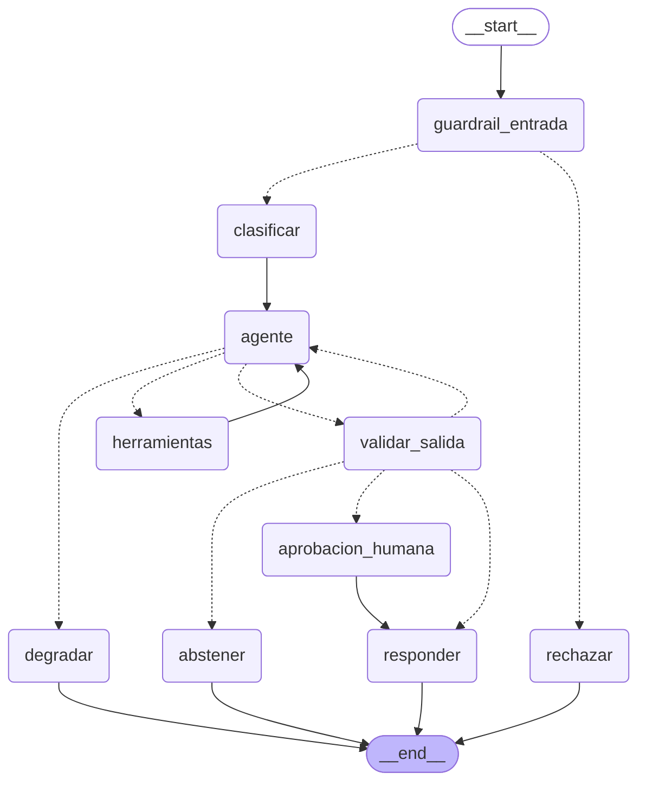

# Asistente NLP/RAG agéntico para tickets de soporte de TI

Proyecto final de CC3103 - Procesamiento de Lenguaje Natural, Universidad del Valle de Guatemala.

Asistente que ayuda al agente de soporte de nivel 1 a clasificar tickets de TI y resolverlos con
procedimientos vigentes y citas verificables. Se abstiene cuando no hay evidencia y no ejecuta
acciones críticas sin aprobación humana. Todos los datos son ficticios o públicos.

**Equipo:** Diego Linares, Christian Echeverría, Andy Fuentes y Diederich Solis.

**Estado:** fase de herramientas terminada, con las cuatro correcciones de la revisión del 17 de noviembre.
El sistema de evaluación ya está armado y corre con un banco borrador. Reportes por fase:
[línea base](resultados/linea_base/reporte_linea_base.md), [RAG](resultados/rag/reporte_rag.md),
[herramientas](resultados/herramientas/reporte_herramientas.md) y
[evaluación con el banco borrador](resultados/evaluacion/banco_borrador/reporte.md).

## Para el equipo

- **Anteproyecto:** [docs/Anteproyecto_Proyecto_Final_CC3103.docx](docs/Anteproyecto_Proyecto_Final_CC3103.docx), la
  versión corregida. Quedó desactualizado en tres puntos que hay que cambiar en el documento técnico:
  - La revisión humana del clasificador se activa si algún voto discrepa, no con 0.6.
  - τ vale 0.0045, no 0.30.
  - Los tickets resueltos se buscan en un canal aparte, no mezclados con los procedimientos.
- **Cómo funciona por dentro:** el diagrama de abajo y los tres reportes por fase. Cada decisión está
  justificada con números.
- **Qué sigue:**

  | Fase | Responsable | Fecha | Qué falta |
  |---|---|---|---|
  | Evaluación | Andy | 20 nov | Revisar y reescribir el banco borrador como `evaluacion/banco.jsonl` (guía en [evaluacion/LEEME_banco.md](evaluacion/LEEME_banco.md)), correrlo, revisar a mano una muestra y analizar las fallas |
  | Seguridad | Diederich | 23 nov | Nombres con Presidio y 12 pruebas adversarias documentadas |
  | Entrega | Todos | — | Documento técnico de 10 a 15 páginas y demo de 15 minutos |

  También faltan los 20 tickets escritos a mano para evaluar el clasificador. Debe escribirlos alguien
  que no redactó F3.
- **Cada quien usa su propia API key de Anthropic.** Va en su `.env`, que nunca se sube. No la compartan
  por chat.

## La demo

Una página para ver el sistema funcionando: el grafo se ilumina paso a paso mientras corre, la respuesta
trae sus citas (cada una abre el fragmento y el PDF en la página exacta) y, cuando hay una acción sensible,
aparece la ventana de aprobación de N2. Trae ejemplos para los seis puntos que pide el enunciado: consulta
nominal, trazabilidad de citas, abstención, herramientas, seguridad y fallas. La pestaña Evaluación muestra
las métricas del banco y el diagnóstico de una falla real.

```bash
docker compose up -d
cd demo && npm install && npm run build && cd ..   # una vez, o cuando cambie la página (necesita Node 20+)
uv run uvicorn tickets_rag.api:app --host 127.0.0.1 --port 8000
```

Después abran `http://127.0.0.1:8000`. El backend es FastAPI (`src/tickets_rag/api.py`) y manda cada paso
del grafo con Server-Sent Events. La página es React con Vite y Tailwind (`demo/`). Para cambiar la página
con recarga en vivo: dejen corriendo uvicorn, corran `npm run dev` en `demo/` y abran `http://127.0.0.1:5173`.

Cada ticket gasta tokens de su API key, unos US$0.01 a US$0.03. Los de contraseña y de API caída casi
no gastan.

## El grafo

Generado desde el código con `scripts/dibujar_grafo.py`. Las flechas punteadas son decisiones del grafo.

<!-- grafo:inicio -->

<!-- grafo:fin -->

Para verlo correr paso a paso en LangGraph Studio:

```bash
uv run langgraph dev --no-reload --allow-blocking
```

`--allow-blocking` hace falta porque el grafo usa llamadas síncronas (base de datos, API y modelos locales)
y el servidor de desarrollo, que es asíncrono, las rechaza por defecto.

Después abre en Chrome `https://smith.langchain.com/studio/?baseUrl=http://127.0.0.1:2024` e inicia sesión
con una cuenta gratuita de LangSmith. Con `LANGSMITH_TRACING=false` en el `.env`, los datos no salen de la
máquina. La entrada es `ticket_id`, `rol` y `texto`; si el grafo pide aprobar una acción, Studio muestra la
pausa y se reanuda con `{"aprobada": true, "aprobador": "...", "rol": "N2"}`. `aprobada` tiene que ser un
booleano: `"true"` entre comillas no aprueba.

Usen Studio solo con tickets de prueba. El grafo enmascara el texto antes de guardarlo, pero el servidor de
desarrollo guarda por su cuenta la entrada de cada corrida en `.langgraph_api/`, que no se sube. Borrar el
hilo en Studio la borra.

Con las mismas 37 consultas de validación:

| Métrica | Línea base (BM25, solo F1) | RAG (híbrida + reranker + τ) |
|---|---|---|
| Recall@5 / MRR | 0.72 / 0.64 | 0.95 / 0.93 |
| Abstención correcta | 0.81 | 0.95 |
| Falsas abstenciones | 7 de 30 | 2 de 30 |
| Latencia P95 por ticket | 6.4 s | 6.2 s |
| Costo por ticket | US$0.0074 | US$0.0078 |

Clasificador TF-IDF de la línea base: macro-F1 0.94 en categoría y 0.96 en prioridad, inflado por los datos
sintéticos. Estos números salen de un set de validación interno; los definitivos salen del banco oficial de la fase 4.

## Qué hay aquí

| Ruta | Contenido |
|---|---|
| `docs/` | Anteproyecto (versión corregida) |
| `datos/f1_manual/` | F1: manual ficticio de la mesa de ayuda. Fuente en Markdown y PDFs de las versiones 2026-1 y 2026-2 |
| `datos/f2_microsoft/` | F2: 24 artículos de soporte de Microsoft (CC BY 4.0) en un commit fijo, el Markdown original y el PDF |
| `datos/f3_tickets/` | F3: 300 tickets resueltos sintéticos y los metadatos de su generación |
| `datos/manifiesto.json` | Registro de fuentes: permiso, licencia, formato, versión, vigencia y hash SHA-256 |
| `src/tickets_rag/` | Código: ingesta, PII, búsqueda, clasificador, herramientas, guardrails y el grafo (`grafo.py`) |
| `scripts/` | Pasos del pipeline, en el orden de abajo |
| `evaluacion/validacion_dev.jsonl` | 37 consultas de validación interna. No es el banco oficial de la fase 4 |
| `evaluacion/banco_borrador.jsonl` | Borrador de los 42 casos de la fase 4, para que Andy lo revise; guía en `evaluacion/LEEME_banco.md` |
| `resultados/linea_base/` | Fase 2: métricas de la línea base, calculadas con las primeras 22 consultas |
| `resultados/rag/` | Fase 3: comparación de configuraciones y generación de ambos sistemas con las 37 consultas |
| `resultados/herramientas/` | Clasificador few-shot (desarrollo y prueba) y demostración del grafo de punta a punta |
| `resultados/evaluacion/` | Fase 4: métricas del banco con los tres sistemas, juez LLM y Ragas |
| `demo/` | Página de la demo (React + Vite + Tailwind); el backend está en `src/tickets_rag/api.py` |
| `docker-compose.yml` | PostgreSQL con pgvector, solo en 127.0.0.1:5433; también guarda el historial y el checkpointer |
| `tests/` | Pruebas automáticas, sin llamadas a la API; las de pgvector se saltan si la base no está levantada |

## Cómo correrlo desde cero

**Requisitos:**
- [uv](https://docs.astral.sh/uv/), que instala Python 3.11 y las dependencias fijadas en `uv.lock`.
- Docker Desktop.
- Unos 10 GB libres, para PyTorch y los modelos.

Una GPU NVIDIA acelera los embeddings y el reranker, pero todo funciona en CPU.

```bash
uv sync
cp .env.example .env                          # pon tu ANTHROPIC_API_KEY y una contraseña en POSTGRES_PASSWORD
docker compose up -d                          # PostgreSQL con pgvector
uv run python scripts/ingestar.py             # escribe los chunks en indices/
uv run python scripts/indexar_vectores.py     # embeddings en pgvector; la primera vez descarga los modelos
uv run python scripts/preparar_bd.py          # historial, tablas de acciones y roles (genera sus claves en el .env)
uv run pytest                                 # unas 130 pruebas, ninguna gasta tokens
uv run python scripts/atender_ticket.py "Outlook se queda en Procesando" --rol N1
```

`indices/` y el `.env` no se suben al repo: cada quien los genera con los pasos de arriba.

Las fuentes F1, F2 y F3 ya están en el repo, así que no hace falta regenerarlas. Si cambias un documento a
propósito, registra su nuevo hash con `uv run python scripts/ingestar.py --actualizar-hashes`.

Con pip en lugar de uv, usa `requirements.txt` y agrega `--extra-index-url https://download.pytorch.org/whl/cu128`.

**Reproducir cada fase:**

```bash
uv run python scripts/evaluar_recuperacion.py                   # fase 3: BM25, vectores, RRF y reranker
uv run python scripts/evaluar_clasificador.py                   # fase 2: TF-IDF
uv run python scripts/evaluar_generacion.py --sistema linea_base   # requiere API key
uv run python scripts/evaluar_generacion.py --sistema rag          # requiere API key
uv run python scripts/evaluar_clasificador_llm.py --conjunto desarrollo   # requiere API key
uv run python scripts/demo_grafo.py                             # 7 tickets de punta a punta (requiere API key)
uv run python scripts/evaluar_banco.py --juez-en agente         # fase 4: banco de 42 casos (requiere API key; unos US$5)
```

**Regenerar las fuentes, solo si cambian:**

```bash
uv run python scripts/construir_f1.py         # PDFs de F1 (salida determinista)
uv run python scripts/construir_f2.py         # F2 desde el commit fijo de Microsoft
uv run python scripts/generar_f3.py           # F3 con Haiku 5.5 (requiere API key; el texto cambia en cada corrida)
```

## Decisiones de la línea base

- **Fuente única (MVP):** el índice solo tiene F1. F2, F3, la búsqueda híbrida y el reranking se agregan
  en la fase 3 si mejoran una métrica frente a esta línea base.
- **Segmentación por estructura:** un chunk por procedimiento, de máximo 450 tokens del tokenizer de
  BGE-M3, con 50 de solapamiento. Un paso numerado nunca se parte, aunque cruce de página.
- **Permisos y vigencia dentro de la búsqueda:** BM25 solo puntúa los chunks permitidos para el rol y
  vigentes; la versión anterior solo se recupera si la consulta la pide.
- **PII antes de todo:** correos, teléfonos, DPI y tarjetas se enmascaran antes de indexar y antes de
  llamar al modelo. Los nombres de personas necesitan NER y quedan para Presidio en la fase de seguridad.
- **Citas verificables:** el modelo elige qué fragmentos cita; la fuente y la página salen de los
  metadatos del chunk. Una cita que no está entre lo recuperado provoca un reintento y luego abstención.
- **F3 con semilla:** la semilla fija categoría, prioridad, escenario, fechas y PII ficticia; el modelo
  solo redacta el texto. La prioridad sigue las reglas del procedimiento 1.4 del manual.

## Uso de IA generativa

El texto de los tickets de F3 lo redactó Claude Haiku 5.5 con los parámetros que fija la semilla. Claude
también se usó como apoyo para escribir el manual ficticio y el código; el equipo revisó todo y responde
por ello.
